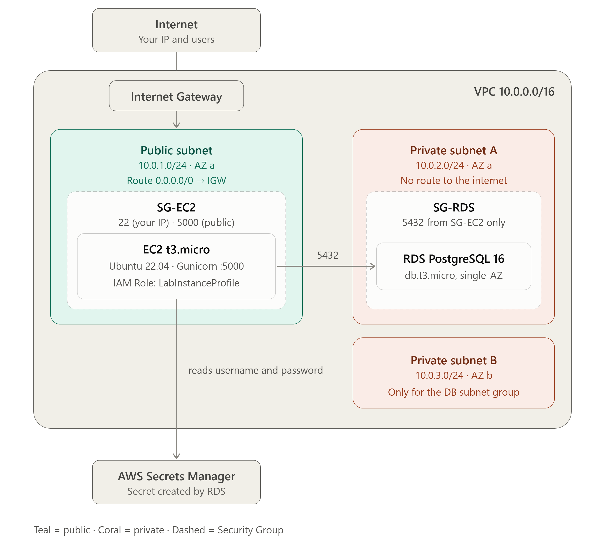

# ToggleMaster AWS Architecture (Phase 1)

This document describes the proposed architecture for deploying the ToggleMaster monolithic application on AWS. In Phase 1, the application is deployed **as is**: an EC2 instance in a public subnet runs the API, a managed PostgreSQL database (RDS) sits in a private subnet, and the database credentials are stored in AWS Secrets Manager.

---

## 1. Overview



---

## 2. Design decisions

1. **Two private subnets.** RDS requires a *DB subnet group* with subnets in at least two Availability Zones, even for a Single-AZ instance. Private subnet B exists only to satisfy this requirement and hosts no resources.
2. **PostgreSQL 16 on RDS.** Standard support for RDS PostgreSQL 13 ended on 02/28/2026; after that date, the version is only maintained through paid *Extended Support*, and AWS recommends upgrading to 16 or later. The application only uses basic SQL (`SERIAL`, `VARCHAR`, `BOOLEAN`, `TIMESTAMPTZ`), so it is compatible with both versions.
3. **SSL on the database.** Starting with PostgreSQL 15, RDS requires SSL connections by default (`rds.force_ssl=1`). The application keeps working without changes, because the default `sslmode` of `psycopg2` (`prefer`) negotiates SSL. Certificate validation is not performed in this phase.
4. **No NAT Gateway.** RDS does not need internet access, and EC2 already has outbound access through the route to the Internet Gateway. A NAT would add a fixed cost with no benefit.
5. **Credentials in AWS Secrets Manager.** RDS creates and maintains the secret with the database username and password. EC2 reads this secret through an IAM Role and exports the environment variables before starting Gunicorn. The password is not typed on the instance or written in the code, and `app.py` does not need to change, since it keeps reading `DB_USER` and `DB_PASSWORD` from the environment.

---

## 3. Network (VPC)

**Region:** `us-east-1` (N. Virginia). AWS Academy limits access to `us-east-1` and `us-west-2`, and the `vockey` key only exists in `us-east-1`.

| Resource | Configuration | Suggested name |
|---|---|---|
| VPC | `10.0.0.0/16` | `togglemaster-vpc` |
| Public subnet | `10.0.1.0/24`, AZ a (EC2) | `togglemaster-public-a` |
| Private subnet A | `10.0.2.0/24`, AZ a (RDS) | `togglemaster-private-a` |
| Private subnet B | `10.0.3.0/24`, AZ b (subnet group only) | `togglemaster-private-b` |
| Internet Gateway | Attached to the VPC | `togglemaster-igw` |
| Public route table | `local` and `0.0.0.0/0 → IGW`, associated with the public subnet | `togglemaster-rt-public` |
| Private route table | `local` only, associated with both private subnets | `togglemaster-rt-private` |

---

## 4. Security Groups

### 4.1 SG-EC2 (`sg-togglemaster-ec2`)

**Inbound:**

| Type | Port | Source | Reason |
|---|---|---|---|
| SSH | 22 | `<your-IP>/32` | Administration, from the operator's IP only |
| Custom TCP | 5000 | `0.0.0.0/0` | The API (Gunicorn) listens on port 5000 |

**Outbound:** default (all traffic allowed), required for `apt`, `pip`, `git clone` and for reading the secret from Secrets Manager (HTTPS).

### 4.2 SG-RDS (`sg-togglemaster-rds`)

**Inbound:**

| Type | Port | Source |
|---|---|---|
| PostgreSQL | 5432 | `sg-togglemaster-ec2` (a reference to the Security Group, not a CIDR) |

### 4.3 Notes

- **HTTP/HTTPS:** the application serves HTTP on port 5000, so the public inbound rule is labeled "HTTP (application, port 5000)". Opening ports 80/443 would only make sense with a reverse proxy or Load Balancer, which are outside the scope of Phase 1.
- **Operator IP:** with a dynamic IP, the SSH rule must be updated whenever the IP changes.

---

## 5. EC2

| Item | Choice | Reason |
|---|---|---|
| AMI | Ubuntu Server 22.04 LTS | Operating system described in the application's README |
| Type | `t3.micro` (2 vCPU, 1 GiB) | Enough for a low-load Gunicorn; allowed on AWS Academy |
| Disk | 8 GiB gp3 (default) | The application is small |
| Network | Public subnet, automatic public IP, SG-EC2 | External access |
| SSH key | `vockey` (Academy, `us-east-1`) or a new `.pem` | SSH access |
| IAM Role | `LabInstanceProfile` (AWS Academy) | Lets EC2 read the database secret without fixed credentials. In a personal account, a role with `secretsmanager:GetSecretValue` restricted to the RDS secret |
| Tools | AWS CLI and `jq` | Reading the secret and extracting username and password |
| Elastic IP | Optional | The dynamic public IP changes when the instance is stopped and started |

**Watch out for Ubuntu 24.04.** It ships with Python 3.12, and the `psycopg2-binary==2.9.5` in `requirements.txt` most likely has no pre-built package for that version. In that case, `pip install` would try to compile it and fail. On Ubuntu 22.04 (Python 3.10) the installation works normally.

---

## 6. RDS

| Item | Choice |
|---|---|
| Engine | PostgreSQL 16.x |
| Template | Dev/Test (or Free tier, if available for the account) |
| Deployment | Single instance, no Multi-AZ |
| Class | `db.t3.micro` (AWS Academy allows micro through medium) |
| Storage | gp3, 20 GiB, no autoscaling |
| Identifier | `togglemaster-db` |
| Master username | `togglemaster` |
| Password | Managed by RDS in AWS Secrets Manager (option *Manage master credentials in AWS Secrets Manager*) |
| Initial database name | `togglemaster` |
| Network | `togglemaster-vpc`, subnet group with `private-a` and `private-b`, AZ a |
| Public access | No |
| Security Group | `sg-togglemaster-rds` |
| Backup | 1-day retention |
| Extras | Performance Insights and Enhanced Monitoring off; Deletion protection off to make cleanup easier |

The **Initial database name** field is essential: if left blank, RDS does not create the `togglemaster` database, and the application fails with `database "togglemaster" does not exist`.

### Environment variables on EC2

`DB_HOST`, `DB_PORT` and `DB_NAME` are not secrets and remain regular variables. `DB_USER` and `DB_PASSWORD` come from the secret created by RDS, which contains the `username` and `password` fields:

```bash
export DB_HOST='<rds-endpoint>'
export DB_PORT='5432'
export DB_NAME='togglemaster'

# DB_USER and DB_PASSWORD are read from the secret created by RDS
SECRET=$(aws secretsmanager get-secret-value \
  --region us-east-1 \
  --secret-id '<secret-arn>' \
  --query SecretString --output text)
export DB_USER=$(echo "$SECRET" | jq -r .username)
export DB_PASSWORD=$(echo "$SECRET" | jq -r .password)
```

**Limitation:** the application reads the password only once, at startup. The secret managed by RDS is rotated automatically (every 7 days by default), and after a rotation the application must be restarted to read the new password.

---

## 7. Environment considerations

- **AWS Academy (Learner Lab):** IAM is restricted (the `LabRole` is used) and the lab session is time-limited. If the EC2 instance is stopped, the dynamic public IP changes; an Elastic IP solves this. It is necessary to confirm that the `LabInstanceProfile` allows reading the secret (`aws secretsmanager list-secrets` on the EC2 instance). If it does not, the alternative is to pass `DB_USER` and `DB_PASSWORD` as environment variables.
- **Personal account:** accounts created on or after 07/15/2025 receive credits (up to US$ 200) for 6 months on the free plan, instead of the 12 months of 750 hours for `t2.micro`/`t3.micro` on older accounts. The current rules should be checked in the Billing dashboard.
- **Public IPv4 has a cost**, even when in use (about US$ 0.005 per hour). This amount is part of the cost estimate.
- **Secrets Manager has a cost:** about US$ 0.40 per secret per month, plus API calls. This amount is also part of the cost estimate.

---

## 8. Out of scope for Phase 1

To keep the architecture simple, the following are not part of this phase: NAT Gateway, Load Balancer, HTTPS (ACM), Multi-AZ, Auto Scaling and CloudWatch Agent. These items appear as future evolution in the recommendations of the 12-Factor analysis.

Since the API has no authentication and port 5000 is open to the public, it is recommended to keep the environment running only during development and evaluation, and to remove the resources afterwards.
