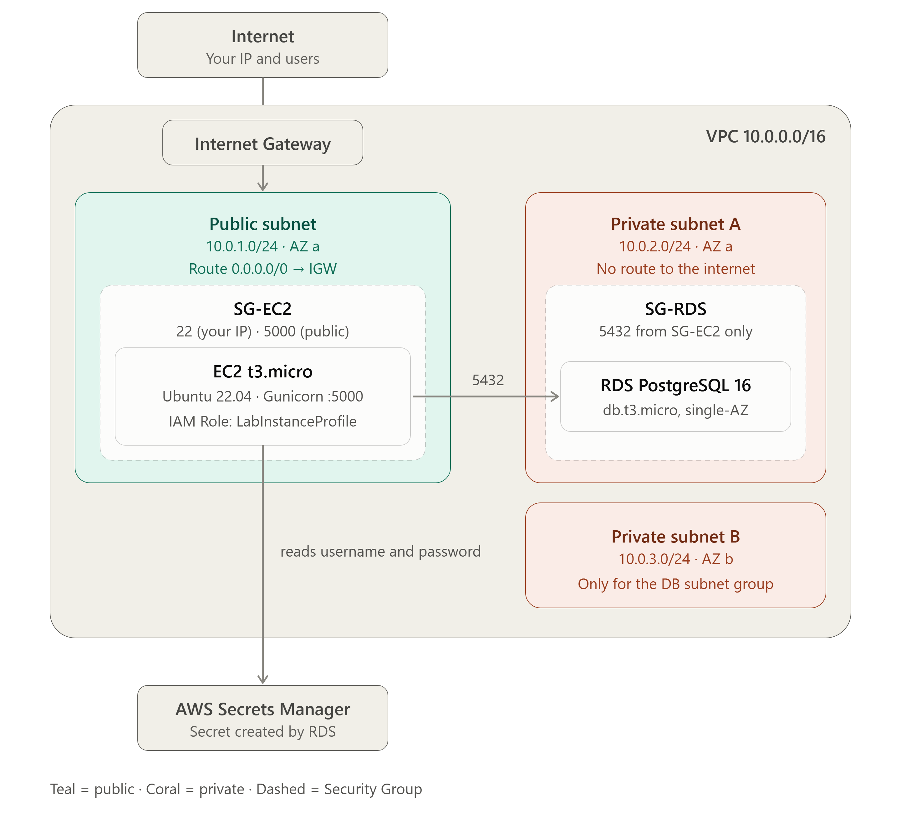

# Arquitetura AWS do ToggleMaster (Fase 1)

Este documento descreve a arquitetura proposta para implantar a aplicação monolítica ToggleMaster na AWS. Na Fase 1, a aplicação é implantada **como está**: uma instância EC2 em sub-rede pública executa a API, um banco PostgreSQL gerenciado (RDS) fica em sub-rede privada e as credenciais do banco ficam no AWS Secrets Manager.

---

## 1. Visão geral



---

## 2. Decisões de projeto

1. **Duas sub-redes privadas.** O RDS exige um *DB subnet group* com sub-redes em pelo menos duas Zonas de Disponibilidade, mesmo em uma instância Single-AZ. A sub-rede privada B existe apenas para cumprir essa exigência e não recebe nenhum recurso.
2. **PostgreSQL 16 no RDS.** O suporte padrão do RDS PostgreSQL 13 terminou em 28/02/2026; depois disso, a versão só é mantida mediante cobrança de *Extended Support*, e a AWS recomenda migrar para a 16 ou superior. A aplicação usa apenas SQL básico (`SERIAL`, `VARCHAR`, `BOOLEAN`, `TIMESTAMPTZ`), então é compatível com ambas as versões.
3. **SSL no banco.** A partir do PostgreSQL 15, o RDS exige conexões com SSL por padrão (`rds.force_ssl=1`). A aplicação continua funcionando sem alterações, porque o `sslmode` padrão do `psycopg2` (`prefer`) negocia SSL. A validação do certificado não é feita nesta fase.
4. **Sem NAT Gateway.** O RDS não precisa acessar a internet, e a EC2 já tem saída pela rota para o Internet Gateway. O NAT teria custo fixo sem benefício.
5. **Credenciais no AWS Secrets Manager.** O RDS cria e mantém o segredo com o usuário e a senha do banco. A EC2 lê esse segredo por meio de uma IAM Role e exporta as variáveis de ambiente antes de iniciar o Gunicorn. A senha não é digitada na instância nem escrita no código, e o `app.py` não precisa ser alterado, pois continua lendo `DB_USER` e `DB_PASSWORD` do ambiente.

---

## 3. Rede (VPC)

**Região:** `us-east-1` (N. Virginia). O AWS Academy limita o acesso a `us-east-1` e `us-west-2`, e a chave `vockey` só existe em `us-east-1`.

| Recurso | Configuração | Nome sugerido |
|---|---|---|
| VPC | `10.0.0.0/16` | `togglemaster-vpc` |
| Sub-rede pública | `10.0.1.0/24`, AZ a (EC2) | `togglemaster-public-a` |
| Sub-rede privada A | `10.0.2.0/24`, AZ a (RDS) | `togglemaster-private-a` |
| Sub-rede privada B | `10.0.3.0/24`, AZ b (apenas subnet group) | `togglemaster-private-b` |
| Internet Gateway | Anexado à VPC | `togglemaster-igw` |
| Route table pública | `local` e `0.0.0.0/0 → IGW`, associada à sub-rede pública | `togglemaster-rt-public` |
| Route table privada | Apenas `local`, associada às duas sub-redes privadas | `togglemaster-rt-private` |

---

## 4. Security Groups

### 4.1 SG-EC2 (`sg-togglemaster-ec2`)

**Entrada:**

| Tipo | Porta | Origem | Motivo |
|---|---|---|---|
| SSH | 22 | `<seu-IP>/32` | Administração, apenas do IP do operador |
| TCP personalizado | 5000 | `0.0.0.0/0` | A API (Gunicorn) escuta na porta 5000 |

**Saída:** padrão (tudo liberado), necessária para `apt`, `pip`, `git clone` e para a leitura do segredo no Secrets Manager (HTTPS).

### 4.2 SG-RDS (`sg-togglemaster-rds`)

**Entrada:**

| Tipo | Porta | Origem |
|---|---|---|
| PostgreSQL | 5432 | `sg-togglemaster-ec2` (referência ao Security Group, não a um CIDR) |

### 4.3 Observações

- **HTTP/HTTPS:** a aplicação serve HTTP na porta 5000, então a regra de entrada pública é rotulada "HTTP (aplicação, porta 5000)". Liberar as portas 80/443 só faria sentido com um proxy reverso ou Load Balancer, que ficam fora do escopo da Fase 1.
- **IP do operador:** com IP dinâmico, a regra de SSH precisa ser atualizada quando o IP mudar.

---

## 5. EC2

| Item | Escolha | Motivo |
|---|---|---|
| AMI | Ubuntu Server 22.04 LTS | Sistema descrito no README da aplicação |
| Tipo | `t3.micro` (2 vCPU, 1 GiB) | Suficiente para um Gunicorn com baixa carga; permitido no AWS Academy |
| Disco | 8 GiB gp3 (padrão) | A aplicação é pequena |
| Rede | Sub-rede pública, IP público automático, SG-EC2 | Acesso externo |
| Chave SSH | `vockey` (Academy, `us-east-1`) ou um `.pem` novo | Acesso via SSH |
| IAM Role | `LabInstanceProfile` (AWS Academy) | Permite à EC2 ler o segredo do banco sem credenciais fixas. Em uma conta pessoal, uma role com `secretsmanager:GetSecretValue` restrita ao segredo do RDS |
| Ferramentas | AWS CLI e `jq` | Leitura do segredo e extração de usuário e senha |
| Elastic IP | Opcional | O IP público dinâmico muda ao parar e iniciar a instância |

**Atenção com o Ubuntu 24.04.** Ele traz Python 3.12, e o `psycopg2-binary==2.9.5` do `requirements.txt` provavelmente não tem pacote pré-compilado para essa versão. Nesse caso, o `pip install` tentaria compilar e falharia. No Ubuntu 22.04 (Python 3.10) a instalação funciona normalmente.

---

## 6. RDS

| Item | Escolha |
|---|---|
| Engine | PostgreSQL 16.x |
| Template | Dev/Test (ou Free tier, se disponível para a conta) |
| Implantação | Instância única, sem Multi-AZ |
| Classe | `db.t3.micro` (o AWS Academy permite de micro a medium) |
| Armazenamento | gp3, 20 GiB, sem autoscaling |
| Identificador | `togglemaster-db` |
| Usuário master | `togglemaster` |
| Senha | Gerenciada pelo RDS no AWS Secrets Manager (opção *Manage master credentials in AWS Secrets Manager*) |
| Initial database name | `togglemaster` |
| Rede | `togglemaster-vpc`, subnet group com `private-a` e `private-b`, AZ a |
| Public access | Não |
| Security Group | `sg-togglemaster-rds` |
| Backup | Retenção de 1 dia |
| Extras | Performance Insights e Enhanced Monitoring desligados; Deletion protection desligada para facilitar a limpeza |

O campo **Initial database name** é essencial: se ficar em branco, o RDS não cria o banco `togglemaster`, e a aplicação falha com `database "togglemaster" does not exist`.

### Variáveis de ambiente na EC2

`DB_HOST`, `DB_PORT` e `DB_NAME` não são segredos e continuam como variáveis comuns. `DB_USER` e `DB_PASSWORD` vêm do segredo criado pelo RDS, que contém os campos `username` e `password`:

```bash
export DB_HOST='<endpoint-do-rds>'
export DB_PORT='5432'
export DB_NAME='togglemaster'

# DB_USER e DB_PASSWORD são lidos do segredo criado pelo RDS
SECRET=$(aws secretsmanager get-secret-value \
  --region us-east-1 \
  --secret-id '<arn-do-segredo>' \
  --query SecretString --output text)
export DB_USER=$(echo "$SECRET" | jq -r .username)
export DB_PASSWORD=$(echo "$SECRET" | jq -r .password)
```

**Limitação:** a aplicação lê a senha uma única vez, ao iniciar. O segredo gerenciado pelo RDS é rotacionado automaticamente (por padrão, a cada 7 dias), e após uma rotação a aplicação precisa ser reiniciada para ler a senha nova.

---

## 7. Considerações sobre o ambiente

- **AWS Academy (Learner Lab):** o IAM é restrito (usa-se a `LabRole`) e a sessão do lab tem tempo limitado. Se a EC2 for parada, o IP público dinâmico muda; o Elastic IP resolve isso. É preciso confirmar que a `LabInstanceProfile` permite ler o segredo (`aws secretsmanager list-secrets` na EC2). Se não permitir, a alternativa é passar `DB_USER` e `DB_PASSWORD` por variáveis de ambiente.
- **Conta pessoal:** contas criadas a partir de 15/07/2025 recebem créditos (até US$ 200) por 6 meses no plano gratuito, em vez dos 12 meses de 750 horas para `t2.micro`/`t3.micro` das contas antigas. As regras vigentes devem ser conferidas no painel Billing.
- **IPv4 público tem custo**, mesmo em uso (cerca de US$ 0,005 por hora). Esse valor entra na estimativa de custos.
- **Secrets Manager tem custo:** cerca de US$ 0,40 por segredo por mês, mais as chamadas à API. Esse valor também entra na estimativa de custos.

---

## 8. Fora do escopo da Fase 1

Para manter a arquitetura simples, não fazem parte desta fase: NAT Gateway, Load Balancer, HTTPS (ACM), Multi-AZ, Auto Scaling e CloudWatch Agent. Esses itens aparecem como evolução nas recomendações da análise 12-Factor.

Como a API não tem autenticação e a porta 5000 fica aberta ao público, recomenda-se manter o ambiente ligado apenas durante o desenvolvimento e a avaliação, removendo os recursos em seguida.
